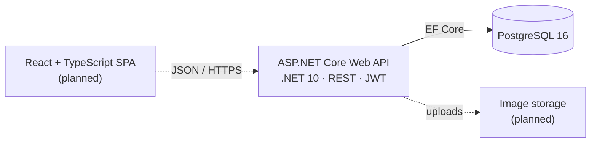

# SoundRevival

A vertical marketplace for buying and selling used musical instruments 
between private users and small shops — built as a **portfolio case 
study** in professional backend and full-stack engineering.

<!-- Badges go here only when they are real: CI status (phase 2),
     deployed API docs (phase 2), license. No placeholder badges. -->

> 🚧 **Work in progress.** Authentication is done; the listings API is 
> being built (roadmap **Phase 1 — Backend foundations**). What exists 
> today is tracked in [docs/dev/STATUS.md](docs/dev/STATUS.md).

## 🎯 Why this project

Generic marketplaces bury instrument listings among thousands of 
unrelated categories. SoundRevival focuses only on instruments, with 
filters designed for this domain (category, brand, condition, price).

The product is the vehicle, not the goal: the goal is to practice the 
full lifecycle of a real project — requirements, architecture, 
implementation, testing, CI/CD, deployment — with the practices used in 
professional teams, and to document every decision along the way.

## ✨ Features (v1 scope)

- Registration and JWT authentication
- Create, edit, delete listings; mark them as sold
- Search by keyword; filter by category, brand, condition and price; 
  sort by newest or price; pagination
- Up to 5 photos per listing
- Seller contact details visible to logged-in users only
- Admin moderation (edit/delete any listing)

v2 (committed, after v1): real-time messaging, simulated payments, admin 
dashboard, dynamic categories, token refresh — see the 
[roadmap](docs/09-Roadmap.md).

## 🏗️ Architecture



The backend is a multi-project solution with compiler-enforced layers 
([ADR-004](docs/adr/ADR-004-Multi-Project-Layered-Backend.md), 
[ADR-011](docs/adr/ADR-011-Core-Infrastructure-Split.md)):

```
Controller (WebApi) → Service (Core) → Repository (Infrastructure, EF Core) → PostgreSQL
                         ↑ depends on interfaces only; DTOs at the boundary
```

`Core` holds entities, interfaces, business rules and exceptions, with 
no EF Core or BCrypt dependency; `Infrastructure` implements its 
interfaces (database, JWT, password hashing).

Details: [docs/06-Architecture.md](docs/06-Architecture.md) · API 
contract: [docs/07-API-Design.md](docs/07-API-Design.md).

## 🛠️ Tech stack

| Layer | Technologies | State |
|---|---|---|
| Backend | C# · ASP.NET Core Web API (.NET 10 LTS) · Entity Framework Core (Code First) | in use |
| Database | PostgreSQL 16 (Docker) | in use |
| Auth | JWT · BCrypt | in use |
| Testing | xUnit · Moq · WebApplicationFactory + Testcontainers · Vitest · Playwright | unit tests in use; others planned |
| Frontend | React · Vite · TypeScript · React Query · Axios | planned (phase 4) |
| Delivery | Docker · GitHub Actions · cloud deployment | planned (phase 2) |
| Observability | Structured logging · OpenTelemetry | planned (phase 5) |

## 🧭 Engineering practices

- **Docs-first, with Architecture Decision Records** — every decision 
  with trade-offs is recorded with the options considered 
  ([ADR index](docs/00-README.md#architecture-decision-records)); 
  living docs are updated in the same PR as the code.
- **Written quality bar** — coding standards per layer, a Definition of 
  Done and a code review checklist 
  ([ENGINEERING-STANDARDS.md](docs/dev/ENGINEERING-STANDARDS.md)); known 
  violations are tracked as technical debt with ids.
- **Requirements → stories → tests** — requirements with stable ids, 
  user stories with Given/When/Then acceptance criteria 
  ([03-UserStories.md](docs/03-UserStories.md)), which become test cases.
- **Testing strategy** — unit tests for business rules, integration tests 
  against a real PostgreSQL, end-to-end tests for critical journeys 
  ([10-Testing.md](docs/10-Testing.md)).
- **Git workflow** — one branch per feature, conventional commits, merges 
  through pull requests.
- **AI-assisted learning, human-written code** — Claude Code acts as a 
  mentor and reviewer, guided by [CLAUDE.md](CLAUDE.md); the code is 
  written by the author.

## 🌐 Live demo

Not deployed yet. The backend goes online with interactive API docs at 
the end of **Phase 2** (deploy early, then continuously); the frontend 
follows in Phase 4. Screenshots will be added with the frontend.

## 🚀 Running locally

**Prerequisites**: .NET 10 SDK, Docker Desktop, `dotnet-ef` 
(`dotnet tool install --global dotnet-ef`).

```bash
git clone https://github.com/nilde790/sound-revival.git
cd sound-revival

# Start PostgreSQL
docker compose up -d
```

Create `backend/SoundRevival.WebApi/appsettings.Development.json` 
(gitignored):

```json
{
  "ConnectionStrings": {
    "DefaultConnection": "Host=localhost;Port=5432;Database=soundrevival;Username=postgres;Password=postgres"
  },
  "Jwt": {
    "Key": "<random secret, at least 32 characters>",
    "Issuer": "SoundRevival",
    "Audience": "SoundRevivalUsers",
    "ExpiryMinutes": 60
  }
}
```

```bash
cd backend

# Apply migrations
dotnet ef database update --project SoundRevival.Infrastructure --startup-project SoundRevival.WebApi

# Run the API (http://localhost:5150)
dotnet run --project SoundRevival.WebApi

# Run tests
dotnet test SoundRevival.slnx
```

Sample requests are in `backend/SoundRevival.WebApi/SoundRevival.WebApi.http`.

## 📁 Documentation

Start from [docs/00-README.md](docs/00-README.md): vision, requirements, 
user stories, domain model, database, architecture, API contract, 
frontend design, roadmap, testing strategy, ADRs, and the development 
guides (status, standards, learning path).

## 🎓 What I learned

<!-- Update at the end of each phase: concrete lessons, not buzzwords. -->

- Why `User.FindFirst("sub")` returns `null` in ASP.NET Core 
  (`MapInboundClaims` remaps JWT claims) and how to read the user id 
  correctly.
- How EF Core change tracking makes a generic `Update` method 
  unnecessary ([ADR-007](docs/adr/ADR-007-No-Generic-Update-In-Repositories.md)).
- How to fix a transitive package vulnerability (NU1903) and a version 
  conflict with direct, documented pins.

## 📄 License

[MIT](LICENSE)
