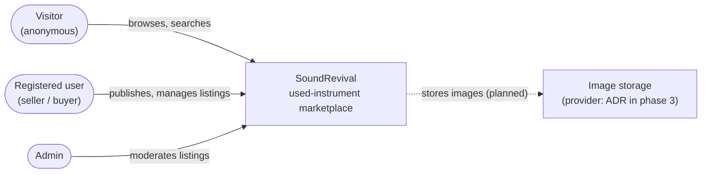
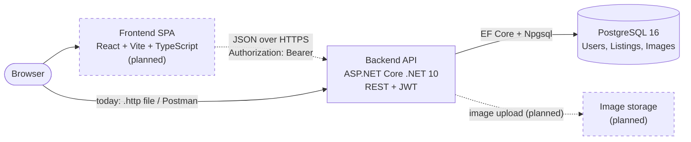

# Architecture

## Overview

This document describes the high-level architecture of the system: its 
main components, how they communicate, and the reasoning behind key 
technology choices. Detailed trade-off discussions for major decisions 
are documented separately as ADRs (see `docs/adr/`).

## System context

Who uses the system and which external systems it depends on (C4 
model, level 1). Dashed elements are planned, not built yet.



## Containers

The deployable parts and how they talk to each other (C4 model, 
level 2).



## Backend

- **Language/Framework**: C# with ASP.NET Core Web API (.NET 10)
- **API style**: Controller-based REST API, following 
  the classic MVC-style controller pattern — chosen for its wide adoption 
  in professional/enterprise environments and clearer separation of 
  concerns for learning purposes
- **ORM**: Entity Framework Core, used to map C# classes to PostgreSQL 
  tables and to handle migrations (**Code First** approach — schema is 
  generated from C# entity classes via EF Core Migrations, rather than 
  generating classes from an existing database)
- **Solution structure**: multi-project .NET Solution 
  (`backend/SoundRevival.slnx`), with clear physical separation between 
  layers (not just folders within a single project):
  - **`SoundRevival.WebApi`** — Controllers, request/response handling, 
    DI registration and authentication middleware (`Program.cs`); no 
    business logic
  - **`SoundRevival.Core`** — domain and business logic, with no 
    EF Core, Npgsql or BCrypt dependency 
    ([ADR-011](adr/ADR-011-Core-Infrastructure-Split.md)):
    - `Entities/` — entity classes (`User`, `Listing`, `Image`), plain C#
    - `Interfaces/` — contracts for repositories, services and 
      infrastructure services (e.g. `IUserRepository`, `IAuthService`, 
      `ITokenService`, `IPasswordHasher`)
    - `Services/` — service implementations containing business logic 
      (e.g. "a user can only edit their own listing", "max 5 images per 
      listing"); they depend only on **interfaces**
    - `Exceptions/` — custom exceptions mapped to `ProblemDetails` 
      ([ADR-009](adr/ADR-009-Error-Handling.md)), including 
      `UniqueConstraintViolationException`, which repositories throw so 
      services never see a database error type
  - **`SoundRevival.Infrastructure`** — implementations of Core's 
    interfaces that talk to the outside world:
    - `AppDbContext.cs` + `Migrations/` — EF Core mapping and schema history
    - `Repository/` — repository implementations: pure EF Core data 
      access, no business rules (e.g. `UserRepository`)
    - `Services/` — `JwtTokenService`, `BCryptPasswordHasher`
    - `Settings/` — `JwtSettings` (validated options)
    - `DependencyInjection.cs` — `AddInfrastructure(configuration)`: 
      registers DbContext, repositories, token service, hasher and 
      options, so `Program.cs` needs no EF Core or provider details
  - **`SoundRevival.Dto`** — Data Transfer Objects, shaping data 
    sent to/from the API, decoupled from internal database entities
  - **`SoundRevival.UnitTests`** — unit tests on services, with 
    interfaces mocked (Moq), tests on `JwtTokenService` and 
    `BCryptPasswordHasher`, and validation tests on request DTOs
- **Dependency direction**: WebApi → Core + Infrastructure + Dto 
  (WebApi is the composition root: it references Infrastructure only to 
  call `AddInfrastructure`); Infrastructure → Core + Dto; Core → Dto; 
  Dto depends on nothing. Infrastructure → Dto exists only because 
  repositories receive filter DTOs (debt A2 in `dev/STATUS.md`). 
  Controllers never access the database directly, and entities never 
  reach the API (controllers only see DTOs)
- **Service lifetimes**: services, repositories and `JwtTokenService` 
  are scoped (one per request, like `AppDbContext`); stateless helpers 
  (`IPasswordHasher`, `TimeProvider`) are singletons. In Development the 
  default host validates the graph on build (`ValidateOnBuild`, 
  `ValidateScopes`), so a wrong lifetime fails at startup
- **Build configuration** (reproducible builds, rules STYLE-2, STYLE-3, 
  STYLE-6):
  - `global.json` (repo root) — SDK pinned to 11.0.1xx 
    (`rollForward: latestPatch`); the projects target .NET 10. It also 
    makes `dotnet test` run on Microsoft.Testing.Platform (TEST-8)
  - `dotnet-tools.json` (repo root) — local tools (`dotnet-ef`), 
    installed with `dotnet tool restore`
  - `backend/Directory.Build.props` — settings shared by every project: 
    target framework, nullable, implicit usings, warnings as errors, 
    analyzers (`Recommended`), code style enforced in build, lock files
  - `backend/Directory.Packages.props` — Central Package Management: 
    every package version in one place, with transitive pinning; 
    `.csproj` files hold only `PackageReference` without `Version`
  - `packages.lock.json` (one per project) — the full resolved 
    dependency tree, committed; CI restores in locked mode
  - `.editorconfig` (repo root) — formatting and code style, checked by 
    the build and by `dotnet format`; `.gitattributes` normalizes line 
    endings; `.git-blame-ignore-revs` hides formatting-only commits from 
    `git blame`
  - `backend/coverage.config` — code coverage settings (generated code 
    excluded), see [10-Testing.md](10-Testing.md#coverage)

```
Controller ──> IXxxService ──> IXxxRepository ──> AppDbContext ──> PostgreSQL
 (WebApi)      (Core/Services)  (Infrastructure/Repository)
```
  
- **Authentication**: token-based (JWT, HMAC-SHA256) — the backend 
  issues a token on login/register, the frontend attaches it to 
  subsequent requests (`Authorization: Bearer <token>`). Passwords are 
  hashed with BCrypt behind `IPasswordHasher`. Token claims: `sub` (user id), `email`, and 
  `ClaimTypes.Role`. Since `MapInboundClaims` is left at its default, 
  `sub` is exposed in controllers as `ClaimTypes.NameIdentifier`. 
  Planned (phase 3, [ADR-012](adr/ADR-012-Browser-Token-Storage.md)): a 
  short-lived access token kept in memory by the frontend, plus a 
  rotating refresh token in an `HttpOnly` cookie, stored hashed in the 
  database and revocable
- **Error handling**: custom exceptions → global `IExceptionHandler` → 
  `ProblemDetails` ([ADR-009](adr/ADR-009-Error-Handling.md))
- **Validation**: DataAnnotations on request DTOs, business rules in 
  services ([ADR-010](adr/ADR-010-Input-Validation.md))
- **Cross-cutting rules**: [dev/ENGINEERING-STANDARDS.md](dev/ENGINEERING-STANDARDS.md); 
  dedicated docs (security, observability, DevOps, AI, performance) are 
  written at the start of their roadmap phase

## Frontend

- **Framework**: React, bundled with **Vite**
- **HTTP client**: Axios, used to communicate with the backend REST API
- **Server state management**: React Query (TanStack Query), handling 
  data fetching, caching, and loading/error states for API calls
- **Local/UI state**: native React hooks (`useState`, `useContext`) — no 
  Redux, since the application's state complexity doesn't justify it at 
  this scope
- **Routing**: React Router, for pages like home, listing detail, create 
  listing, login/register, user profile

## Database

- **Engine**: PostgreSQL (see `05-Database.md` for full schema)
- **Primary keys**: UUID across all tables

## Image storage

- **External storage service**: only the returned URL is stored in the 
  `Images` table. This avoids relying on the application server's 
  filesystem, which is not persistent across redeploys on most hosting 
  platforms.
- **Not decided yet** (ADR at the start of phase 3): the provider 
  (e.g. Cloudinary or the deployment cloud's blob storage) and the upload 
  flow (through the backend or directly from the browser to the storage 
  with a short-lived signed URL; together with the listing or through 
  the separate endpoint in 07-API-Design.md).

## Communication flow (example: creating a listing)

1. User fills out the listing form in React and submits
2. Frontend sends `POST /api/listings` (via Axios), with the JWT in the 
   `Authorization` header
3. Backend validates the token (authentication) and the request data 
   (DataAnnotations); the service checks the business rules
4. Backend saves the listing to PostgreSQL via EF Core
5. Backend returns `201 Created` with a `Location` header and the 
   created listing (as JSON)
6. Frontend updates the UI (React Query invalidates/refetches the 
   listings cache)

How images join this flow is decided with the image storage ADR (see 
Image storage).

## Deployment (high-level)

- **Backend + Database**: platform not chosen yet. It will be an ADR 
  before the deploy item of phase 2, comparing a PaaS that runs a Docker 
  image (e.g. Render) with a cloud provider (Azure Container Apps, AWS) 
  on cost, free-tier limits and professional value. Free tiers change 
  often (see 05-Database.md → Engine). The environment is described as 
  infrastructure as code, and schema migrations are applied by the 
  pipeline (09-Roadmap.md → Phase 2)
- **Frontend**: deployed as a static build, **on the same site as the 
  API** (one origin behind a reverse proxy, or subdomains of one 
  domain), because the refresh token cookie is not sent across sites 
  ([ADR-012](adr/ADR-012-Browser-Token-Storage.md))
- **Containerization**: Docker Compose (`docker-compose.yml` at the 
  repository root). Currently runs only PostgreSQL; backend and frontend 
  services will be added so the whole stack can run together locally

## CI/CD (high-level)

- GitHub Actions workflows (`.github/workflows/`) run automatically on 
  every push/pull request to `main` (NFR-9):
  - Backend: build with zero warnings, `dotnet format --verify-no-changes`
  - Frontend: ESLint, type check (`tsc --noEmit`), build
  - Automated tests (see `10-Testing.md`)
  - Security: dependency updates (Dependabot), code scanning (CodeQL), 
    secret scanning
- A separate deployment workflow builds the container image, applies 
  migrations and deploys (phase 2)
- Merging to `main` is only allowed once the pipeline passes, enforcing 
  a baseline of code quality

## Related documents

- `docs/adr/ADR-001-Architecture.md` — rationale for choosing this 
  overall architecture over alternatives
- `docs/adr/ADR-002-Database.md` — rationale for PostgreSQL and UUIDs
- `docs/adr/ADR-003-Authentication.md` — rationale for JWT-based auth
- `07-API-Design.md` — concrete endpoint definitions
- `08-Frontend-Design.md` — component structure and routing details