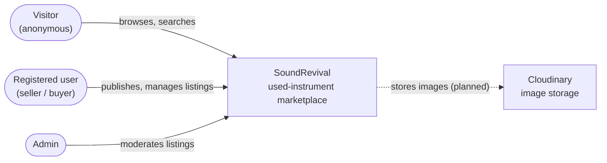
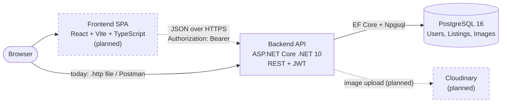

# Architecture

## Overview

This document describes the high-level architecture of the system: its 
main components, how they communicate, and the reasoning behind key 
technology choices. Detailed trade-off discussions for major decisions 
are documented separately as ADRs (see `docs/adr/`).

## System context

Who uses the system and which external systems it depends on (C4 
model, level 1). Dashed elements are planned, not built yet.



## Containers

The deployable parts and how they talk to each other (C4 model, 
level 2).



## Backend

- **Language/Framework**: C# with ASP.NET Core Web API (.NET 10)
- **API style**: Controller-based REST API, following 
  the classic MVC-style controller pattern — chosen for its wide adoption 
  in professional/enterprise environments and clearer separation of 
  concerns for learning purposes
- **ORM**: Entity Framework Core, used to map C# classes to PostgreSQL 
  tables and to handle migrations (**Code First** approach — schema is 
  generated from C# entity classes via EF Core Migrations, rather than 
  generating classes from an existing database)
- **Solution structure**: multi-project .NET Solution 
  (`backend/SoundRevival.slnx`), with clear physical separation between 
  layers (not just folders within a single project):
  - **`SoundRevival.WebApi`** — Controllers, request/response handling, 
    DI registration and authentication middleware (`Program.cs`); no 
    business logic
  - **`SoundRevival.Repository`** — domain, business logic and data access:
    - `Entities/` — EF Core entity classes (`User`, `Listing`, `Image`)
    - `AppDbContext.cs` + `Migrations/` — EF Core mapping and schema history
    - `Interfaces/` — contracts for both repositories and services 
      (e.g. `IUserRepository`, `IAuthService`)
    - `Repository/` — repository implementations: pure EF Core data 
      access, no business rules (e.g. `UserRepository`)
    - `Services/` — service implementations containing business logic 
      (e.g. "a user can only edit their own listing", "max 5 images per 
      listing"); they depend on repository **interfaces**, never on 
      `AppDbContext` directly
  - **`SoundRevival.Dto`** — Data Transfer Objects, shaping data 
    sent to/from the API, decoupled from internal database entities
  - **`SoundRevival.Tests`** — unit tests on services, with repository 
    interfaces mocked (Moq)
- **Dependency direction**: WebApi → Repository (via interfaces) + Dto; 
  Repository → Dto; Dto depends on nothing. Controllers never access the 
  database directly, and entities never leave the Repository project 
  (controllers only see DTOs)

```
Controller ──> IXxxService ──> IXxxRepository ──> AppDbContext ──> PostgreSQL
 (WebApi)        (Services/)      (Repository/)
```
  
- **Authentication**: token-based (JWT, HMAC-SHA256) — the backend 
  issues a token on login/register, the frontend attaches it to 
  subsequent requests (`Authorization: Bearer <token>`). Passwords are 
  hashed with BCrypt. Token claims: `sub` (user id), `email`, and 
  `ClaimTypes.Role`. Since `MapInboundClaims` is left at its default, 
  `sub` is exposed in controllers as `ClaimTypes.NameIdentifier`
- **Error handling** ([ADR-009](adr/ADR-009-Error-Handling.md)): services 
  throw a small set of custom exceptions for expected failures; one 
  global `IExceptionHandler` maps them to status codes and returns RFC 
  9457 `ProblemDetails`. Controllers contain no `try/catch`
- **Validation** ([ADR-010](adr/ADR-010-Input-Validation.md)): 
  DataAnnotations on request DTOs, checked automatically by 
  `[ApiController]` (`400` + `ValidationProblemDetails`); business rules 
  stay in services
- **Cross-cutting rules** (validation, error handling, concurrency, 
  async/cancellation, logging, security, configuration, testing) are 
  defined in [dev/ENGINEERING-STANDARDS.md](dev/ENGINEERING-STANDARDS.md). 
  Dedicated documents for security, observability, DevOps, AI 
  integration and performance are written at the start of the roadmap 
  phase that needs them (see 09-Roadmap.md)

## Frontend

- **Framework**: React, bundled with **Vite**
- **HTTP client**: Axios, used to communicate with the backend REST API
- **Server state management**: React Query (TanStack Query), handling 
  data fetching, caching, and loading/error states for API calls
- **Local/UI state**: native React hooks (`useState`, `useContext`) — no 
  Redux, since the application's state complexity doesn't justify it at 
  this scope
- **Routing**: React Router, for pages like home, listing detail, create 
  listing, login/register, user profile

## Database

- **Engine**: PostgreSQL (see `05-Database.md` for full schema)
- **Primary keys**: UUID across all tables

## Image storage

- **Cloudinary**, external cloud storage. The backend uploads images 
  received from the frontend to Cloudinary, then stores only the 
  returned URL in the `images` table. This avoids relying on the 
  application server's filesystem, which is not persistent across 
  redeploys on most free hosting platforms.

## Communication flow (example: creating a listing)

1. User fills out the listing form in React and submits, including images
2. Frontend sends a POST request (via Axios) to the backend API, with 
   the JWT token in the Authorization header
3. Backend validates the token (authentication) and the request data
4. Backend uploads each image to Cloudinary, receiving back a URL for each
5. Backend saves the listing and image URLs to PostgreSQL via EF Core
6. Backend returns the created listing (as JSON) to the frontend
7. Frontend updates the UI (React Query invalidates/refetches the 
   listings cache)

## Deployment (high-level)

- **Backend + Database**: platform not chosen yet. It will be an ADR 
  when deployment starts, comparing a PaaS that runs a Docker image 
  (e.g. Render) with a cloud provider (Azure Container Apps, AWS) on 
  cost, free-tier limits and professional value. Free tiers change 
  often (see 05-Database.md → Engine)
- **Frontend**: deployed separately as a static build (e.g. Vercel, 
  Netlify, or the same cloud provider's static hosting)
- **Containerization**: Docker Compose (`docker-compose.yml` at the 
  repository root). Currently runs only PostgreSQL; backend and frontend 
  services will be added so the whole stack can run together locally

## CI/CD (high-level)

- GitHub Actions workflows (`.github/workflows/`) run automatically on 
  every push/pull request to `main` (NFR-9):
  - Backend: build with zero warnings, `dotnet format --verify-no-changes`
  - Frontend: ESLint, type check (`tsc --noEmit`), build
  - Automated tests (see `10-Testing.md`)
- Merging to `main` is only allowed once the pipeline passes, enforcing 
  a baseline of code quality

## Related documents

- `docs/adr/ADR-001-Architecture.md` — rationale for choosing this 
  overall architecture over alternatives
- `docs/adr/ADR-002-Database.md` — rationale for PostgreSQL and UUIDs
- `docs/adr/ADR-003-Authentication.md` — rationale for JWT-based auth
- `07-API-Design.md` — concrete endpoint definitions
- `08-Frontend-Design.md` — component structure and routing details